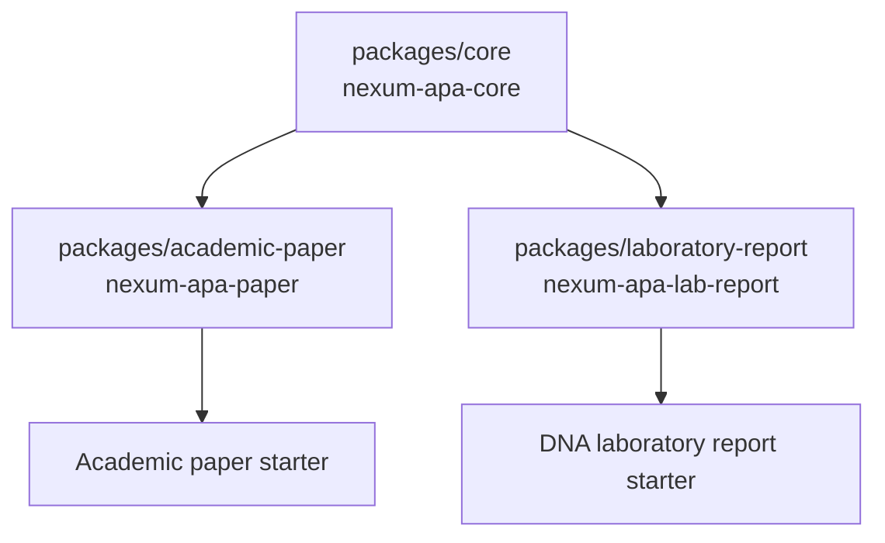

# Architecture

## Design goals

1. Authors edit document data and section content, not formatting internals.
2. Academic papers and laboratory reports share one APA composition engine.
3. The three packages are independently versioned and published, while being
   developed and tested together in one GitHub monorepo.
4. Template packages contain starter files; the visual and structural logic
   remains in the shared core package.
5. The repository folder names are decoupled from public Typst package IDs.

## Package graph

`nexum-apa-paper` and `nexum-apa-lab-report` import the published core package
using a versioned `@preview` import. The core must be accepted and available in
Typst Universe before either dependent package is submitted.

There is no general dependency declaration field in the package manifest for
this setup; package dependencies are expressed by imports in `lib.typ`.

## Monorepo directories and package identity

| Monorepo directory | `typst.toml` package name |
|---|---|
| `packages/core/` | `nexum-apa-core` |
| `packages/academic-paper/` | `nexum-apa-paper` |
| `packages/laboratory-report/` | `nexum-apa-lab-report` |

The local installer and registry preparation scripts read the actual manifest
name and version. They must not assume the parent directory equals the package
name.

## Core modules

- `src/document.typ`: orchestrates document composition.
- `src/metadata.typ`: normalizes `metadata.yaml` into a stable internal schema.
- `src/settings.typ`: resolves `settings.yaml` into typed values and lengths.
- `src/content.typ`: renders semantic section manifests for academic and lab
  documents in the template-defined order.
- `src/styles/page.typ`: page size, margins, and page-number header.
- `src/styles/typography.typ`: independent text, math, and raw-code font setup.
- `src/styles/headings.typ`: APA heading hierarchy and title behavior.
- `src/styles/captions.typ`: APA figure/table caption presentation.
- `src/components/cover.typ`: configurable student cover.
- `src/components/abstract.typ`: abstract and keywords.
- `src/components/bibliography.typ`: native Typst bibliography element.
- `src/components/figures.typ`: in-flow figure/table wrappers and notes.
- `src/components/run-in-heading.typ`: helper for APA run-in heading levels.

The core stores the document title once as PDF metadata and renders it with
Typst's semantic `title()` element. The title is not modeled as a numbered
section heading.

## Template packages

Each template package has two parts:

- `lib.typ`: public API that imports the core and chooses the document-specific
  semantic section order.
- `template/`: starter project files copied to the user's project when the
  template is instantiated.

The template project's `main.typ` loads `metadata.yaml`, `settings.yaml`,
`content.typ`, and `references.bib`, then invokes the appropriate template.
The `content.typ` manifest makes file discovery explicit because Typst does not
provide automatic directory enumeration.

## Paths and asset ownership

User-owned files stay in the generated project. The package receives the user's
bibliography as a `path` value. The core must not attempt to open user files by
constructing paths relative to its own package root. Package and project roots
are isolated by Typst for reproducibility and safety.
